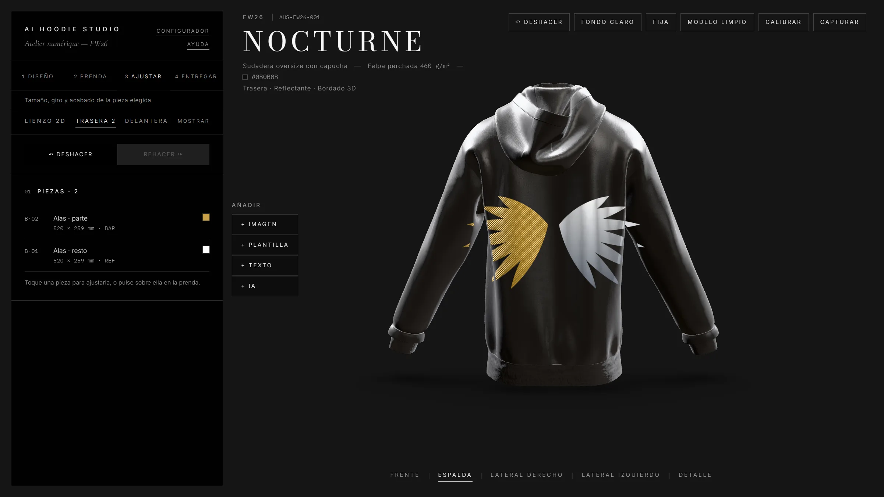
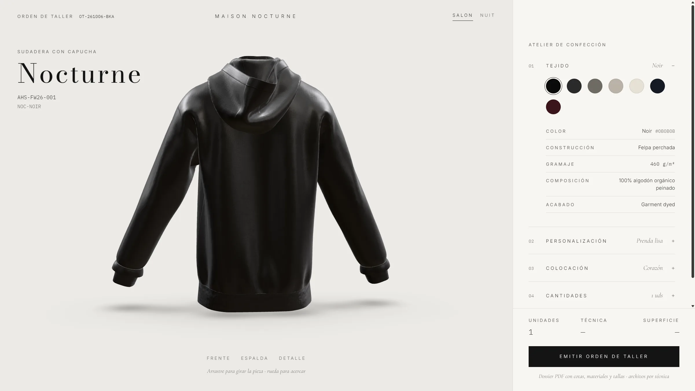

# AI Hoodie Studio

[](LICENSE)


A digital atelier to **design hoodies with AI** and produce a **production-ready workshop dossier**. You place graphics on a 3D garment, choose how each piece is made (screen print, reflective ink, 3D embroidery, tone-on-tone embroidery), and export a tech-pack PDF with vector dimensions plus one file per technique.

It also includes a **workshop configurator** that turns choices (fabric, personalization, placement, quantities per size) into a numbered **work order**.

> **Open source.** This project is released under the [MIT license](LICENSE). Use it, modify it, build on it, even commercially. No permission needed, no warranty given. If it is useful to you, a star or a mention is appreciated but not required.

<p align="center">
  <br>
  <em>The atelier. Each graphic is a separate piece with its own colour and technique, projected live onto the 3D garment.</em>
</p>

<p align="center">
  <br>
  <em>The workshop configurator: fabric, personalization, placement and quantities become a work order.</em>
</p>

> **Language note.** The app's interface and its built-in user manual are in **Spanish**. This README is in English; the original, more detailed Spanish README is kept as [README.es.md](README.es.md). Translations and an i18n layer would be welcome contributions.

---

## Contents

1. [What it does](#what-it-does)
2. [How it works](#how-it-works)
3. [Getting started](#getting-started)
4. [You must bring your own 3D model](#you-must-bring-your-own-3d-model)
5. [AI generation and API keys](#ai-generation-and-api-keys)
6. [The four tools](#the-four-tools)
7. [Production techniques](#production-techniques)
8. [The workshop dossier and work order](#the-workshop-dossier-and-work-order)
9. [Tech stack](#tech-stack)
10. [Project structure](#project-structure)
11. [Status and known limitations](#status-and-known-limitations)
12. [License and credits](#license-and-credits)

---

## What it does

- **Design with AI**: type a concept and generate artwork with DALL·E 3 (or Recraft v3 for pure vector SVG). Three "collection directions" steer the style: *Silent luxury* (default), *Technical archive* and *Gothic*.
- **Edit directly on the garment**: select a graphic on the 3D hoodie, drag it, resize it from the corners, rotate it with the handle. Every change is live in 3D.
- **Per-piece finishes**: each piece has its own colour or two-colour gradient and its own technique. Nine one-tap "quick looks" (silver, chrome, embroidered gold, neon...).
- **Split a graphic into parts**: paint a mask (brush, eraser, wand, rectangle, circle, triangle, polygon) and separate a zone, for example one wing embroidered and the other reflective.
- **Crop and duplicate**: crop copies to a rectangle (text on top, drawing below...). Each crop becomes an independent piece in the dossier.
- **Undo / redo** (Ctrl+Z / Ctrl+Y) per garment face, 40 steps.
- **Garment options**: fabric colour, fabric sheet (construction, weight, composition, finish), hardware (eyelets, aglets, drawcord).
- **Export**: a PDF workshop dossier with vector dimensions, and a ZIP with one file per technique (SVG / 300 dpi PNG).
- **All-over pattern mode** (`/patron`, in development): place a design across the flat pattern pieces and see it sewn on the 3D garment.
- **Workshop configurator** (`/configurador`): produce garment variants and a numbered work order.

## How it works

The core idea is a **2D design canvas that drives a 3D preview**.

1. **Each garment face has a 2D canvas** built with Fabric.js. Images, text and templates are Fabric objects. A piece's technique and ink are stored as data on the object.
2. **The canvas becomes textures.** One texture per technique is filtered out of the same Fabric canvas (screen print, reflective, embroidery) and used to texture a decal.
3. **Decals are projected, not UV-mapped.** The graphic is projected onto the hoodie mesh using drei's `<Decal>`, with the position and scale computed by raycasting onto the surface. Because it does not rely on the model's UVs, **any GLB hoodie works** regardless of how it was unwrapped. The projection is split into one patch per fabric panel, so a graphic crosses seams, sleeves and the hood cleanly. Each face prints only on its own half of the garment and does not stretch at the sides.
4. **Each technique has its own material.** Matte for screen print; a physical material with clear coat and metalness for reflective ink; a sheen plus a generated bump map for 3D embroidery; and for tone-on-tone embroidery the thread follows the fabric colour, revealing itself only through relief and gloss under raking light.
5. **Direct editing inverts the projection.** Selecting and dragging on the 3D garment uses the exact inverse of the projection to find the matching spot on the 2D canvas.
6. **Real-world units.** The canvas uses `7 px = 1 cm`. All measurements in the dossier are in millimetres from the **HPS** (high point shoulder), the usual garment-industry origin. The recommended print area is 38 x 48 cm on the back (10 cm below the HPS) and 30 x 24 cm on the front (15 cm below the HPS), but the whole garment is editable.
7. **Production output is computed, not drawn.** The PDF is built with jsPDF from the same Fabric objects, so the drawings and dimensions always match what you see. Estimated stitch counts come from the real area covered by thread (the opaque pixels of each piece's render) times a workshop density (3 stitches/mm² for satin, 3.6 for relief).
8. **Lighting is built for products.** A procedurally generated softbox studio (no HDRI downloads), directional rim lights to cut the silhouette, Khronos PBR Neutral tone mapping (the e-commerce standard, which does not shift fabric colour), and a procedural brushed-fleece normal map.

## Getting started

Requirements: **Node.js 20.9 or newer** and npm.

```bash
git clone https://github.com/ImSothe/AI-Hoodie-Studio.git
cd AI-Hoodie-Studio
npm install

# 1. Add your 3D model (required, see the next section):
cp /path/to/your/hoodie.glb public/models/hoodie.glb

# 2. Run it:
npm run dev        # http://localhost:3000
```

On Windows you can also double-click `Iniciar-Atelier.bat` (builds and opens the app) or `Iniciar-Atelier-Desarrollo.bat` (development mode with live reload).

| Script | What it does |
|---|---|
| `npm run dev` | Development server (picks up a new GLB when you click "Reintentar") |
| `npm run build` | Production build, including the type check. Rebuild after changing the GLB |
| `npm start` | Serves the production build |
| `npm run typecheck` | TypeScript only |
| `npm run fonts:pdf` | Regenerates the PDF fonts from the `@fontsource` WOFF files (only if you change the PDF fonts) |

## You must bring your own 3D model

The viewer always loads `public/models/hoodie.glb`. **No model is included** and there is no demo mode or fallback: without the file, the viewer shows a full-screen notice asking for it.

- Format: GLB (glTF 2.0 binary). If it uses Draco compression, drei downloads the decoder from its CDN.
- Orientation: ideally facing **+Z** (the glTF convention). Otherwise use the in-app **Calibrate** panel (orientation, height, scale).
- The model is normalized automatically: scaled to 0.84 m tall and centred.
- Designs are projected with `<Decal>`, so the model's UV layout does not matter, **except** for the `/patron` all-over mode, which uses the UVs as the pattern.
- Where to get a model: Sketchfab (filter "Downloadable"), CGTrader, TurboSquid, or export your own from CLO3D, Marvelous Designer or Blender.

**Check the model's licence** before using it commercially or publishing screenshots of it. See [public/models/README.md](public/models/README.md) (in Spanish) for the calibration details.

## AI generation and API keys

AI generation is **optional**. Without a key the Generate button is disabled, and everything else (uploading images, templates, text, all editing, export and the configurator) works normally.

| Where | What |
|---|---|
| **Settings** in the app | Paste your OpenAI API key. It is saved in your browser's `localStorage` and sent in the `x-openai-key` header to `/api/generate`, which calls DALL·E 3 and neither stores nor logs it. |
| `OPENAI_API_KEY` in `.env.local` | A server-side key, used when the user has not pasted their own. |
| `RECRAFT_API_KEY` in `.env.local` | An alternative that returns pure vector SVG, used when no OpenAI key exists. |

Copy `.env.example` to `.env.local` if you want server-side keys. `.env*` files are git-ignored.

**Image generation is a paid API.** DALL·E 3 charges per image (the app shows an approximate cost). Set a spending limit on your key.

> **Security note.** `localStorage` is readable by any script on the same origin, and the generation endpoint has **no rate limit** yet. Run it locally or on an internal domain, and do not expose it publicly with a server-side key.

The request body accepts `style: 'silence' | 'archive' | 'gothic'` and rejects anything else. Options include a vertical 1024x1792 format (for the back) or square, 1-4 variations, and HD quality. Every direction asks for white on pure black so the background can be cut out losslessly.

## The four tools

| Route | Purpose |
|---|---|
| `/` **Atelier** | Design: AI, free canvas, techniques per piece, hardware and the dossier. The main tool. Four steps: Design, Garment, Adjust, Deliver. |
| `/configurador` **Workshop** | Produce variants without touching the canvas: fabric, personalization, placement, quantities by size, then a **work order**. A workshop tool, not a shop: no prices, no cart. |
| `/patron` **Pattern** | All-over printing across the flat pattern pieces (in development). |
| `/ayuda` **Manual** | An interactive user manual with a searchable side menu and zoomable screenshots, written in Spanish (`docs/MANUAL-USUARIO.md`). |

### The workshop configurator in five steps

1. **Fabric**: stock colour and fabric sheet (construction, weight, composition, finish).
2. **Personalization**: initials or a word, a typeface, and a technique with its code (embroidery tone-on-tone, relief embroidery or screen print) plus thread or ink reference. With no text the order is for a plain garment.
3. **Placement**: heart, chest, nape or back, each with its box and dimensions in mm from the HPS, and the measured real size after applying.
4. **Quantities**: units per size, XS to XXL. Placements refer to size M; the workshop scales with its own grading table.
5. **Order**: order number (`OT-YYMMDD-XXX`), variant code, technique, placement, production and per-size breakdown.

The editable catalogue (model, stock colours, techniques, threads, typefaces, approved placements and sizes) lives in `src/lib/configurador/collection.ts`.

## Production techniques

| Code | Technique | 3D rendering |
|---|---|---|
| `SER` | Flat screen print | Decal with a matte standard material |
| `REF` | Reflective ink | Decal with a physical material (low roughness, high metalness, clear coat) and a local environment |
| `BAR` | Relief embroidery | Decal with thread sheen and a generated bump map (a blurred silhouette for padding times a stitch pattern) |
| `BTT` | Tone-on-tone embroidery | Same decal, but the thread follows the fabric's hex (exact, or a barely visible +/-7% shade); satin or matte finish painted per pixel into a roughness map |

Ink and thread references follow `CODE-HEX[-SAT|-MAT]`, for example `BTT-0B0B0B-SAT`. Pantone or Madeira matches are made at the workshop from a sample; CMYK values are approximate.

When a piece is switched to tone-on-tone, its previous ink is remembered, and if you later change the garment colour the thread follows it automatically.

## The workshop dossier and work order

The dossier is an A4 PDF with hairline rules (0.07 to 0.1 mm), vector dimensions, and coordinates in mm from the HPS. It contains:

- A cover with the full-garment render.
- A placement sheet with dimensions.
- Materials and hardware.
- A production order by size.
- One file per technique (SVG / 300 dpi PNG).

The project's typefaces are embedded in the PDF (Times, Helvetica and Courier as fallbacks).

## Tech stack

| Layer | Technology |
|---|---|
| Framework | Next.js 16 (App Router), React 19, TypeScript |
| 2D canvas | Fabric.js 7 |
| 3D | three.js, @react-three/fiber 9, @react-three/drei 10 |
| State | zustand |
| AI | OpenAI DALL·E 3 (user key or server key), Recraft v3 as a vector alternative |
| Export | jsPDF (dossier with vector dimensions), JSZip |
| Colour | react-colorful |
| Fonts | Self-hosted @fontsource: Inter, Bodoni Moda, Cormorant Garamond, IBM Plex Mono, plus bold display faces |
| Styling | Tailwind CSS 4 |

## Project structure

| Path | Contents |
|---|---|
| `src/app/` | Routes: `/`, `/configurador`, `/patron`, `/ayuda`, and `api/generate` |
| `src/components/three/` | 3D scene, decal projection, direct editing, lighting, hardware |
| `src/components/canvas/`, `sidebar/`, `studio/`, `pattern/` | The Fabric canvas and the editing panels |
| `src/lib/three/decalPlacement.ts` | The projection: an orthographic projector plus one `DecalGeometry` patch per fabric panel |
| `src/lib/hoodie/spec.ts` | Physical scale, HPS and print areas |
| `src/lib/configurador/collection.ts` | The workshop catalogue |
| `src/lib/fabric/` | Effects, parts, undo/redo history |
| `src/lib/ai/` | The AI providers |
| `docs/MANUAL-USUARIO.md` | The user manual (Spanish) |
| `public/manual/` | Manual screenshots |

## Status and known limitations

This is a working project, not a finished product. Please read this before relying on it.

- **The AI integration was developed against simulated responses** and has not been verified end to end against the live OpenAI and Recraft APIs. Test it with your own key.
- **Most visual testing used a generated test model**, plus a real GLB in later sessions. Eyelet and placement positions depend on where the HPS sits in *your* model, so expect to use the Calibrate panel.
- **No 3D model is included** (see above), so a fresh clone shows a notice until you add one.
- **The interface and manual are in Spanish only.**
- **Helvetica Neue is a system font** (macOS and iOS). On Windows it is previewed with Inter Light.
- **The `/patron` mode is in development.** Still pending: gradients, seamless side panels, a dossier that includes the pattern, persistence, and testing with a real mouse and touch screen (tests used synthetic pointer events).
- **Suggested next steps:** project persistence, vectorizing the DALL·E PNG, a size-grading table, a Madeira/Pantone thread library, and a rate limit on the AI endpoint.
- **No automated tests yet.** `npm run typecheck` and `npm run build` are the safety net.

Contributions are welcome. Open an issue first for anything large.

## License and credits

- Code: **[MIT](LICENSE)**, Copyright (c) 2026 Sothe ([@ImSothe](https://github.com/ImSothe)).
- Fonts: bundled under the SIL Open Font License; see [public/fonts/pdf/LICENSES.txt](public/fonts/pdf/LICENSES.txt).
- The 3D hoodie model shown in the screenshots is not part of this repository.
- Built with Next.js, React, three.js, react-three-fiber, drei, Fabric.js and jsPDF.
